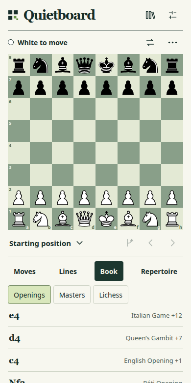

# Quietboard

A separate Android chess notebook, package `org.quietboard.chess`. It opens directly on a board. The board, piece gestures, notation, pages, layout and controls were written for Quietboard; it does not embed the InstinctaZero interface. An install does not update or read that app. Portrait; Android 8.0/API 26 or newer.

## Use

- Tap a destination, select an origin then its destination, or drag. To correct a guessed move, drag it back, then tap the destination again for the next legal origin. Promotions prompt for a piece. Displayed root arrows take precedence over guesses.
- Use the arrows below the board to navigate; hold to repeat. The fork control returns to the latest notation or selected-repertoire intersection. The position name opens jump, setup and import actions. Long-press notation to promote or delete a branch. Forward follows the first child. PGN import/export supports nested variations and move comments.
- Moves, Lines, Book and Repertoire share one board. Active engine scores stay above it; tap a score to inspect the lines. Stockfish Lite (~1.9 MB) and Full (~99 MB) are explicit one-time verified downloads, retained when off. No engine binary or weights ship inside the APK. Independently enable PC Leela or Stockfish after pairing. Engine searches stop off the board and in the background. PC analysis and explorer use the existing guarded service; there is no new server. Leela/PC/phone root arrows use that priority order. Root arrows and same-piece maneuver lengths are configurable; Leela alternatives use visits/evaluation, and Stockfish alternatives use evaluation only.
- Book → Openings is an offline curated guide, not game-frequency statistics. Masters/Lichess are online explorers with game counts, outcome bars and Lichess rating/speed filters. Hold a result to inspect outcome counts. Direct Lichess OAuth is optional and separate from PC credentials.
- Library contains studies, completed games, and local or downloaded repertoires. Create and select White/Black repertoires, extend a played route, navigate transpositions, edit notes and recommendations, or undo the last edit. The library supports paired-PC source download and user-controlled backup/restore. Auto-backup is off unless enabled.
- Position setup supports a piece palette, erase and drag, turn/castling/en passant, copy/paste FEN, actual reversal and flip. Analyse opens a separate study. Position → Return to saved board goes back to the source. Local drafts are recoverable under the setup tools.
- Privacy hides names, titles and comments on the screen and blocks Android screenshots while enabled. PGN export explicitly preserves the original metadata.

## Build

Set `JAVA_HOME` to a JDK 17 and `ANDROID_HOME` to an SDK with platform 35 and Build Tools 35.0.0. Run `./gradlew assembleDebug` for an installable debug APK or `./gradlew assembleRelease` for an unsigned release. No signing secret is required in the project. The built-in assets are checked in; Node is only necessary for optional vendor rebuilds or the Chromium smoke test.

For the focused synthetic phone-browser test, run Node 22+, install Playwright separately, and run `PLAYWRIGHT_MODULE=/path/to/playwright CHROME_PATH=/path/to/chromium node tests/smoke.cjs`. Set `SF_FIXTURE` to an external directory with the two upstream Stockfish Lite assets to exercise a real offline search as well. The harness binds only to loopback. All test games and positions are synthetic. It writes screenshots to ignored `test-output/`.

## Scope and provenance

Nonvisual mobile adapters, the indexed repertoire store, Cburnett piece artwork, chess.js rules and the offline Click Chess model were sourced from InstinctaZero Android commit `3963710`. Quietboard has its own board renderer, screens, controls, iconography, navigation and app identity. No existing accounts, games, downloaded packs or private databases are imported. See [notices](app/src/main/assets/licenses/NOTICES.txt), [GPL](LICENSE), and [vendor sources](vendor/) for attribution, preferred upstream source, and notices.

Not a pixel or workflow clone: the offline guide is deliberately small; archive pages are explicitly paginated; there is no standalone evaluation chart. The app uses its own variation-aware study format and does not migrate existing studies automatically. Imported PGN is a single game at a time (5,000 move nodes / 600 KB). PC pairing, device OAuth, archive calls, backup/restore, public explorer and on-device WebView behavior require a real deployment to verify end-to-end; the local checks deliberately do not contact the service or a phone.
